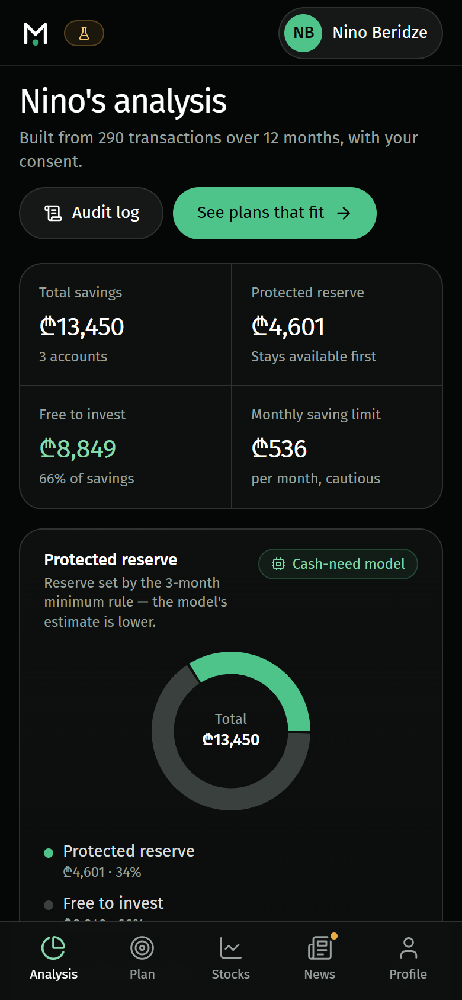
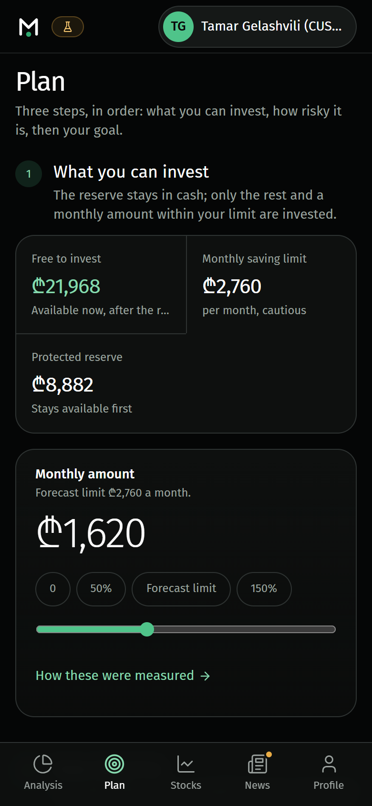
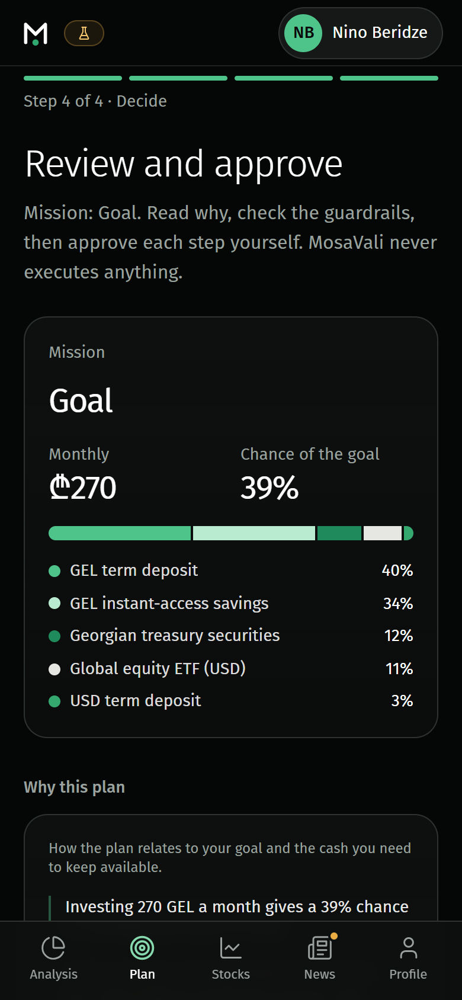
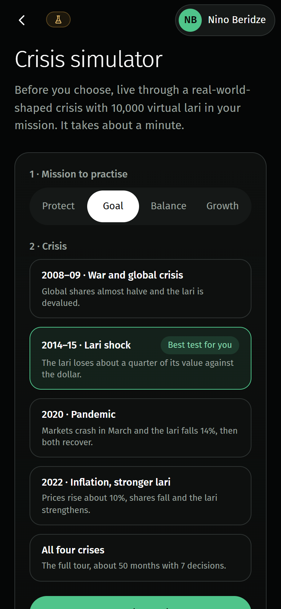
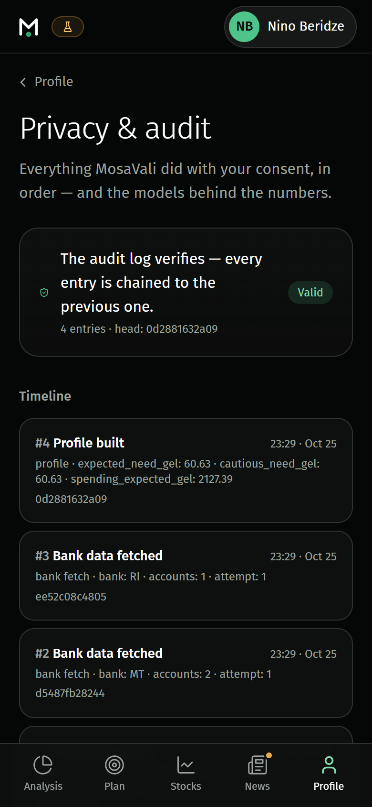
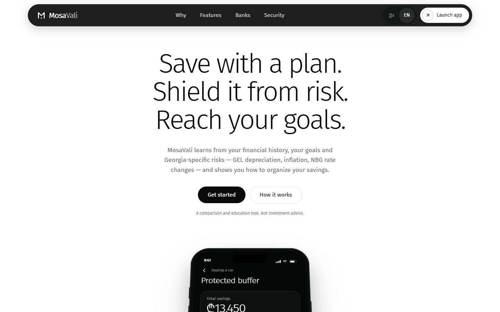

# MosaVali

**A goal-based savings and investment copilot for Georgian savers. It advises; the customer decides.**

AI & Open Banking Hackathon, Tbilisi · Direction 1: AI in Finance · Problem space: Algorithmic Trading & Portfolio Optimization

**Live demo: https://amazing-florentine-744660.netlify.app**

> All customer data in this project is **synthetic**. MosaVali never moves money: approved steps become a draft instruction for a licensed bank or broker.

---

## Contents

1. [The problem and our solution](#1-the-problem-and-our-solution)
2. [Try it in two minutes](#2-try-it-in-two-minutes)
3. [What the prototype does](#3-what-the-prototype-does)
4. [Setup and run](#4-setup-and-run)
5. [Architecture overview](#5-architecture-overview)
6. [How the AI works](#6-how-the-ai-works)
7. [Guardrails and controls in the code](#7-guardrails-and-controls-in-the-code)
8. [Data](#8-data)
9. [Testing and quality](#9-testing-and-quality)
10. [Known limitations](#10-known-limitations)
11. [Third-party components and licences](#11-third-party-components-and-licences)
12. [Repository layout](#12-repository-layout)

---

## 1. The problem and our solution

Georgian savers often **earn in lari but save for goals priced in dollars**, such as an apartment down payment or an imported car. Most keep their savings in deposits or cash, and few can tell whether they are on track, how much cash they should keep accessible, or how a lari depreciation or a market crash would affect their plan.

MosaVali answers three questions for one concrete goal:

| Question | What MosaVali does |
|---|---|
| **Can I reach my goal?** | With the customer's consent it reads their bank accounts, protects an emergency cash reserve first, works out a safe monthly saving amount, and estimates the chance of reaching the goal on time across 1,500 simulated economic scenarios. |
| **How should I invest?** | It compares four plans built from deposits, treasury securities and diversified fund types, each tested against lari depreciation, inflation and global crashes. |
| **How much goes where?** | It proposes exact amounts and transfers, explains them in plain Georgian or English, and checks them against compliance rules. The customer approves, edits or rejects every step. |

**What "AI" means here:** two trained machine-learning regression models, a clustering model, a CVaR portfolio optimiser, a Monte Carlo simulator and exact Shapley explanations. **There is no LLM or chatbot**: every explanation sentence is generated from computed numbers, so it cannot invent facts.

---

## 2. Try it in two minutes

Open the **[live demo](https://amazing-florentine-744660.netlify.app)**, or run it locally (section 4) and use `http://127.0.0.1:8000` instead.

> The live backend runs on a free plan that sleeps when idle. The first request can take up to a minute; sessions reset when it restarts.

The quickest way in is a demo link. Each one creates a real consent session for a synthetic customer:

| Link (add to the site address) | What it shows |
|---|---|
| `/app/demo/nino` | Nino, a salaried saver with a dollar-priced car goal: the full analysis |
| `/app/demo/cus-007?next=/app/plan` | An organiser customer with an apartment down-payment goal over five years |
| `/app/demo/nino?next=/app/plan/decide` | The decision step: explanation, compliance checks, trade approval and the instruction draft |
| `/app/demo/nino?timeout=RI` | A bank that doesn't respond: partial-data fallback instead of invented data |
| `/app/demo/lamara?next=/app/plan/mission` | Lamara, a pensioner: choose **Growth** and the vulnerable-customer rule blocks it on the decision step |
| `/app/demo/nino?next=/app/sandbox` | The crisis simulator |
| `/app/demo/cus-001` … `/app/demo/cus-100` | Any of the 100 customers from the organisers' workbook |

Or start from **`/app/welcome`** and enter your own numbers (income, spending, savings, goal) or import a CSV bank statement. The statement is parsed in the browser; only summary numbers are sent to the server.

**Suggested path for the jury:** open a demo customer → **Analysis** (reserve and monthly limit) → **Plan** (goal chance; change the monthly amount and watch it update) → plan steps → **Decide** (approve a trade, try an edit above the limit and see it blocked) → **Profile → Privacy** (verified audit log, then revoke consent).

### Screenshots

| Analysis | Plan | Decide |
|---|---|---|
|  |  |  |

| Crisis simulator | Audit log |
|---|---|
|  |  |



---

## 3. What the prototype does

The app has five tabs. Every screen carries a **Synthetic data** badge, and numbers produced by a model carry a small model chip.

| Tab | What it shows (all numbers come from the backend) |
|---|---|
| **Analysis** | Risk capacity; the **protected cash reserve** (cash-need model) and why; the **safe monthly saving limit** (spending model); a savings finder that compares optional spending with similar people (peer model); income stability, dollar exposure and the customer's **personal inflation rate** |
| **Plan** | The goal, its **chance of success** and the monthly amount, with levers ("what would get you there"); the plan steps *reserve → mission → stress test → decide*; the crisis simulator; goal editing |
| **Stocks** | Live prices and a **one-stock what-if**: what putting money in a single stock would do to the goal's odds. Educational only; a single stock is never added to a plan. |
| **News** | Updates from the profiler, then live headlines per stock |
| **Profile** | Data source, consent (banks, scopes, expiry), accounts, the **hash-chained audit log**, the model card, and **consent revocation** |

**The four missions** (plans), each optimising a different objective:

| Mission | Objective |
|---|---|
| Protect | Smallest losses in bad years while beating the customer's own inflation (equity ≤ 10%) |
| Goal | The highest chance of reaching the goal on time within the customer's risk capacity; de-risks in the final year |
| Balance | Middle of the risk–return frontier |
| Growth | Highest expected growth the customer's capacity allows |

If no mission reaches the goal, MosaVali says so and shows what would help: saving more (within the limit), allowing more time, or a cheaper goal.

**The decision step:** the customer acknowledges any warnings, reads a short explanation (full evidence is expandable), and approves, edits or rejects each proposed transfer. Edits are re-checked by compliance. Only approved steps go into the signed-ready instruction for the partner bank or broker.

---

## 4. Setup and run

**Requirements:** Python 3.12 and Node.js 20 or newer (tested with Node 24 locally, Node 22 on Netlify).

One server serves both the web app and the API, so after building the app runs from a single command.

### Windows (PowerShell or Git Bash)

```bash
# 1. Backend
cd backend
python -m venv .venv
.venv/Scripts/python.exe -m pip install -r requirements.txt

# 2. Web app (in PowerShell use npm.cmd if npm is blocked by the execution policy)
cd ../webapp
npm ci
npm run build

# 3. Run everything on one port
cd ../backend
.venv/Scripts/python.exe -m uvicorn danazogi.api:app --port 8000
```

### macOS / Linux

```bash
cd backend && python3.12 -m venv .venv && .venv/bin/pip install -r requirements.txt
cd ../webapp && npm ci && npm run build
cd ../backend && .venv/bin/python -m uvicorn danazogi.api:app --port 8000
```

Then open **http://127.0.0.1:8000**. On first start the API trains the ML models (about 10 seconds), because trained model files are not stored in the repository.

| Address | What it is |
|---|---|
| `http://127.0.0.1:8000/` | Landing page |
| `http://127.0.0.1:8000/app/welcome` | Start of the app |
| `http://127.0.0.1:8000/app/demo/nino` | Demo customer (see section 2) |
| `http://127.0.0.1:8000/docs` | Interactive API documentation (Swagger) |
| `http://127.0.0.1:8000/api/health` | Health check with model versions |

**Development mode (optional):** run the API on port 8001 (`--port 8001`), then `cd webapp && npm run dev`. The Vite dev server proxies `/api` to `API_TARGET` (default `http://127.0.0.1:8001`).

**Retrain the models:** `cd backend && .venv/Scripts/python.exe -m danazogi.ml.registry`

**Deployment:** the live demo hosts the web app on Netlify (`netlify.toml`) and the API on Render (`render.yaml`). Netlify forwards `/api/*` to Render, so the browser sees a single origin.

---

## 5. Architecture overview

```
 Browser: React + TypeScript PWA, Georgian / English
   │   webapp/src/services/backend.ts is the only API client; there is no mock data
   │   and no financial calculation in the browser
   ▼   JSON over HTTPS, per-session consent token
 FastAPI server (backend/danazogi/api.py)
   │   serves the built web app, the /api routes and a read-only market-data relay
   ▼
 Orchestrator (backend/danazogi/orchestrator.py) runs the agent pipeline for a consent session:

   Consent ─► Bank fetch (retry, partial-data fallback)
          ─► Ingestion        categories, income type, essential vs optional, GEL vs USD costs
          ─► Cash-need model  protected reserve                        (ML regression)
          ─► Spending model   safe monthly saving limit                (ML regression)
          ─► Profiler         risk capacity, equity cap, alerts
          ─► Peer groups      spending benchmarks, savings opportunities (ML clustering)
          ─► Inflation        personal inflation, goal price index
          ─► Missions + CVaR  4 portfolios, Monte Carlo goal probability
          ─► Compliance       pass / warn / block per rule
          ─► Explainability   exact Shapley values → plain-language sentences
          ─► Trade proposals  ─► customer approves / edits / rejects ─► signed-ready instruction

   Side paths: crisis simulator → behaviour score → compliance · goal edits · fund and one-stock comparison
   Cross-cutting: consent store (scopes, token, expiry, purge) · hash-chained audit log on every step
```

| Layer | Code | Technology |
|---|---|---|
| Web app | `webapp/src/` | React 18, TypeScript, Vite, Tailwind CSS, Recharts, installable PWA |
| API | `backend/danazogi/api.py` | FastAPI, Pydantic |
| Pipeline and approval flow | `backend/danazogi/orchestrator.py` | Python 3.12 |
| Agents | `backend/danazogi/agents/` | ingestion, liquidity, spending, profiler, peers, inflation, stress (CVaR), missions, funds, compliance, explain, execution, sandbox |
| Machine learning | `backend/danazogi/ml/` | scikit-learn, NumPy |
| Optimiser | `backend/danazogi/agents/stress.py` | SciPy (HiGHS linear-programming solver) |
| Synthetic data and assumptions | `backend/danazogi/data/` | personas, organiser-workbook loader, market assumptions, crisis replays |
| Consent and audit | `backend/danazogi/consent.py`, `audit.py` | in-memory sessions, SHA-256 hash chain |

The full API contract (endpoints, status codes, the plan → approve → instruction order) is in [`docs/API.md`](docs/API.md).

---

## 6. How the AI works

### Machine-learning models

All three models are trained on a **20,000-customer synthetic cohort** (24 months each, with hidden life events such as job loss, medical costs and an FX shock). The split is customer-disjoint: **12,000 train · 3,000 validation · 2,000 calibration · 3,000 test**, plus a separate **5,000-customer stress cohort** modelling a 2014-style year with 30% depreciation. Features come only from the first 12 months and targets from months 13–24, so no future information leaks into the inputs. The model with the lowest validation error is selected; the test set is never used for selection.

**Gender, age band and region are never inputs to the regressions.** They are used only to audit error across groups.

| Model | Predicts | Used for | Held-out test result |
|---|---|---|---|
| **Cash-need regression** (gradient boosting) | The largest essential-cash shortfall (GEL) over the next 12 months, plus a calibrated 90% cautious bound | Protected reserve = max(3 months of essential costs, cautious estimate) | MAE 1,183 / RMSE 2,166 GEL vs baseline 1,987 / 2,817; bound coverage 89.2% (stress cohort 84.9%) |
| **Spending regression** (Ridge + quantile bound) | Total spending next month, including one-off costs | Safe monthly saving limit, enforced by rule AFF-01 | Cautious-bound coverage 90.1% (stress cohort 90.3%); RMSE 483 GEL, on par with the recent-average baseline (484) |
| **Peer groups** (k-means, 10 groups) | The customer's situation group | Spending benchmarks and savings opportunities | Stability (ARI) 0.92; smallest group 1,020 people (privacy floor 50) |

What the cash-need model adds: it raises the reserve above the simple 3-month rule for **38.5%** of test customers, and the share whose reserve covers their real 12-month cash need rises from **85.0% to 92.1%**.

The spending model is built for **safety rather than point accuracy**: its calibrated cautious bound, which caps the monthly saving amount, covers **90.1%** of test customers and holds at **90.3%** in the stress cohort, while its point forecast performs on par with a strong recent-average baseline. Full details, fairness tables and limitations are in [`docs/MODEL_CARD.md`](docs/MODEL_CARD.md).

### Portfolio optimiser and goal probability

- **Scenarios:** 1,500 seeded paths per horizon simulate lari depreciation with crisis jumps (8% crisis probability per year, 12–32% depreciation), GEL inflation with FX pass-through, US inflation, NBG rate moves and global equity crashes. Each asset is valued in lari after fees, against the customer's own costs: GEL costs grow with GEL inflation, dollar-linked costs with the exchange rate.
- **Assets:** current account, USD cash, GEL and USD term deposits, treasury securities, and a global equity index fund (a fund type, not a product).
- **Optimisation:** a Rockafellar–Uryasev **CVaR(95%) linear program**. It maximises expected real growth while keeping the average loss in the worst 5% of scenarios within a budget. The cash reserve is a hard constraint, and concentration is capped at 40% per deposit or treasury asset. Tests confirm the LP's CVaR matches the empirical CVaR and that no random feasible portfolio beats it.
- **Goal probability:** Monte Carlo. Monthly contributions are added along each path, and the final amount is compared with the goal's own price index (dollar-priced goals follow the exchange rate). It is a simulation under labelled assumptions, not a promise.

### Explanations

The optimiser is treated as a function of four customer features: horizon, share of dollar-linked costs, liquidity need and mission risk level. It is re-run for all 2⁴ = 16 combinations of the customer's values and a reference saver's, which gives **exact Shapley values** for every asset weight. Sentences are built deterministically from those numbers, in Georgian and English, with the numbers shown as evidence.

### Crisis simulator

The customer practises with 10,000 virtual lari through stylised replays of 2008–09, 2014–15, 2020 and 2022, deciding at key moments whether to hold, sell, rebalance or buy more. Their behaviour becomes a risk score (1–10) that compliance compares with the mission they choose (rule BEH-01).

---

## 7. Guardrails and controls in the code

| Control | Where in the code |
|---|---|
| **No execution.** Every trade needs individual customer approval; no instruction is produced before approval | `orchestrator.py` → `decide_trade`, `instruction` |
| Explicit acknowledgment before a warned mission (HTTP 409 until acknowledged) | `orchestrator.py` → `select_mission` |
| Vulnerable-customer block (VULN-01) | `agents/compliance.py` → `check_mission` |
| Risk-capacity and simulator-behaviour checks (CAP-01, BEH-01) | `agents/compliance.py` → `check_mission`, `behaviour_rank` |
| Cash reserve locked in the optimiser (BUF-01) | `agents/stress.py` → `Constraints.bounds`, `liquid_row` |
| Concentration limits and equity cap (CONC-01) | `agents/stress.py` → `CAPS`; `agents/compliance.py` → `check_portfolio` |
| Source-account balance and chronological reserve checks across all trades (SOURCE-01, BUF-01) | `agents/compliance.py` → `check_portfolio`; `orchestrator.py` → `_trade_checks`, `decide_trade` |
| Monthly amount must fit cash flow, including edits (AFF-01) | `agents/compliance.py` → `check_recurring`; `orchestrator.py` → `select_mission`, `decide_trade` |
| Diversified fund types only; a single stock never enters a plan (PROD-01) | `agents/funds.py` → `stock_check`, `PROD_RULE` |
| Essential spending is never suggested as a cut (SPEND-01) | `ml/peer_model.py` → `opportunities` |
| Term deposits are never broken early | `agents/execution.py` → `proposals`; `agents/sandbox.py` → `apply` |
| Bank timeout: retry, then partial-data mode with a larger reserve, zero saving limit and adviser flag (DATA-01) | `orchestrator.py` → `connect`; `agents/liquidity.py` |
| Hash-chained audit log with tamper detection; model versions recorded on each entry | `audit.py` → `AuditLog.append`, `verify` |
| Consent scopes, per-session token (constant-time check), expiry, purge with receipt | `consent.py` → `ConsentStore`, `revoke` |
| Protected attributes never regression inputs; group error and coverage audit | `ml/regression.py` → `train` |
| Cautious bound calibrated on held-out data (90% population coverage target) | `ml/regression.py` → `train` |
| k-anonymity floor for peer groups | `ml/peer_model.py` → `MIN_GROUP` |
| Deterministic explanations, no free-text generation | `agents/explain.py` → `narrative` |
| Goal edits recompute everything and are audited | `orchestrator.py` → `update_goal` |
| Invalid inputs (negative, NaN, infinite, out-of-range) rejected | `api.py` request models |

The compliance rule set is versioned (`compliance-1.1`). These controls are covered by the automated tests in `backend/tests/`.

---

## 8. Data

| Source | Use |
|---|---|
| Synthetic personas (`backend/danazogi/data/mock_open_banking.py`) | Nino, Lamara, Giorgi and Tamar: invented people, banks, IBANs and 12 months of transactions |
| Organisers' workbook (`open_banking_synthetic_100_customers.xlsx`) | 100 customers converted to an open-banking (NextGenPSD2-style) format. The workbook has no goals, so one is assumed from each profile, labelled "assumed" and editable. Used for inference only. |
| Your own numbers / CSV statement | Turned into synthetic transactions; the normal pipeline runs unchanged |
| TBC Open Banking mock sandbox | Status probe only; no accounts are imported |
| Training cohort (`backend/danazogi/ml/cohort.py`) | 20,000 synthetic savers for training and evaluation |
| Market assumptions (`backend/danazogi/data/market.py`) | Returns, volatilities, crisis probability, category inflation, crisis replays. All labelled as assumptions in the app. |
| Live market data (Stocks and News tabs only) | Yahoo Finance prices through a read-only relay, GDELT headlines, National Bank of Georgia rates. If unavailable, the app says so; **plans never depend on live data**. |

---

## 9. Testing and quality

```bash
cd backend && .venv/Scripts/python.exe -m pytest -q        # backend tests
cd webapp && npm run build && npm test                    # type check + build + unit tests
node webapp/scripts/journey.mjs http://127.0.0.1:8000     # end-to-end browser journey (app must be running)
node webapp/scripts/a11y.mjs http://127.0.0.1:8000 en     # accessibility scan (also run with ka)
```

- **Backend tests** cover ML quality against baselines, CVaR correctness, missions, every compliance rule, simulator rules, the bank-timeout fallback, audit tamper detection, consent purge and the API.
- **End-to-end journey** (Playwright) clicks through the main flows and checks for page errors and layout overflow.
- **Accessibility:** axe-core WCAG 2.1 A/AA scan in English and Georgian.
- **Unit tests** (Vitest) for the CSV statement parser.

On Windows, very long FastAPI TestClient runs can occasionally crash natively. If that happens, run the test files separately.

---

## 10. Known limitations

1. **Synthetic data.** The metrics show the models recover patterns in synthetic data; real-world accuracy has not been validated. Retraining on partner history is supported (`python -m danazogi.ml.external file.csv`, 24 consecutive months per customer).
2. **The spending model is tuned for a safe upper bound,** not point accuracy; real transaction history would let it improve on the recent-average baseline.
3. **TBC is a status check,** not an authenticated bank connection. Production access needs a partner agreement.
4. **No money moves.** The output is a draft instruction for a licensed partner, which gives the regulated advice and suitability sign-off.
5. **Sessions are in memory.** A server restart ends them; multiple server instances would need a shared store.
6. **Market and macro parameters are assumptions.** Allocations are sensitive to the crisis probability, depreciation and concentration caps. Taxes and fund access costs for Georgian residents are not modelled. The 2008–09 and 2022 replay paths are rounded approximations.
7. **No seasonal backtest:** the synthetic target month is October.

---

## 11. Third-party components and licences

### Backend (Python, pinned in `backend/requirements.txt`)

| Component | Version | Licence |
|---|---|---|
| FastAPI | 0.143.0 | MIT |
| Starlette | 1.7.0 | BSD-3-Clause |
| Pydantic | 2.14.1 | MIT |
| Uvicorn | 0.54.0 | BSD-3-Clause |
| NumPy | 2.5.4 | BSD-3-Clause (with bundled permissive licences) |
| SciPy (includes the HiGHS solver) | 1.18.1 | BSD-3-Clause (HiGHS: MIT) |
| scikit-learn | 1.9.1 | BSD-3-Clause |
| joblib | 1.6.0 | BSD-3-Clause |
| httpx | 0.28.1 | BSD-3-Clause |
| pytest (tests only) | 9.1.1 | MIT |

Remaining entries in `requirements.txt` are pinned transitive dependencies of the packages above.

### Web app (npm, pinned in `webapp/package-lock.json`)

| Component | Version | Licence |
|---|---|---|
| React, React DOM | 18.3.1 | MIT |
| React Router | 6.28.0 | MIT |
| Recharts | 2.13.3 | MIT |
| Lucide React (icons) | 0.460.0 | ISC |
| FiraGO font (Fontsource) | 5.3.0 | OFL-1.1 |
| Noto Sans Georgian font (Fontsource) | 5.3.0 | OFL-1.1 |
| Vite, @vitejs/plugin-react | 5.4.11, 4.3.4 | MIT |
| vite-plugin-pwa | 0.21.1 | MIT |
| TypeScript | 5.6.3 | Apache-2.0 |
| Tailwind CSS, PostCSS, Autoprefixer | 3.4.17, 8.4.49, 10.4.20 | MIT |
| Vitest (tests only) | 2.1.8 | MIT |
| Playwright (tests only) | 1.49.1 | Apache-2.0 |
| axe-core (tests only) | 4.10.2 | MPL-2.0 |

### External services

| Service | Use |
|---|---|
| Yahoo Finance (public chart and search endpoints) | Live stock prices on the Stocks tab, via a read-only relay |
| GDELT Project API | News headlines |
| National Bank of Georgia public API | Exchange rate, policy rate, TIBR |
| TBC Bank Open Banking mock sandbox | Connectivity probe |
| Netlify, Render | Hosting of the live demo |

---

## 12. Repository layout

```
backend/
  danazogi/            Python package (the project's original working name)
    api.py             FastAPI routes and static serving
    orchestrator.py    agent pipeline, approval flow, audit
    consent.py         consent sessions and purge
    audit.py           hash-chained audit log
    agents/            ingestion, liquidity, spending, profiler, peers, inflation,
                       stress (CVaR), missions, funds, compliance, explain, execution, sandbox
    ml/                synthetic cohort, regressions, peer clustering, model registry, metrics
    data/              synthetic personas, organiser-workbook loader, market assumptions
  tests/               backend tests
webapp/
  src/                 React app: pages, components, API client, session state, ka/en translations
  public/              icons, sample CSV statement, landing-page data snapshot
  scripts/             end-to-end journey, accessibility scan and helper scripts
docs/
  MODEL_CARD.md        models, metrics, fairness, limitations
  API.md               API contract
  screenshots/         images used in this README
open_banking_synthetic_100_customers.xlsx   organisers' synthetic workbook
netlify.toml, render.yaml                   deployment configuration for the live demo
```
